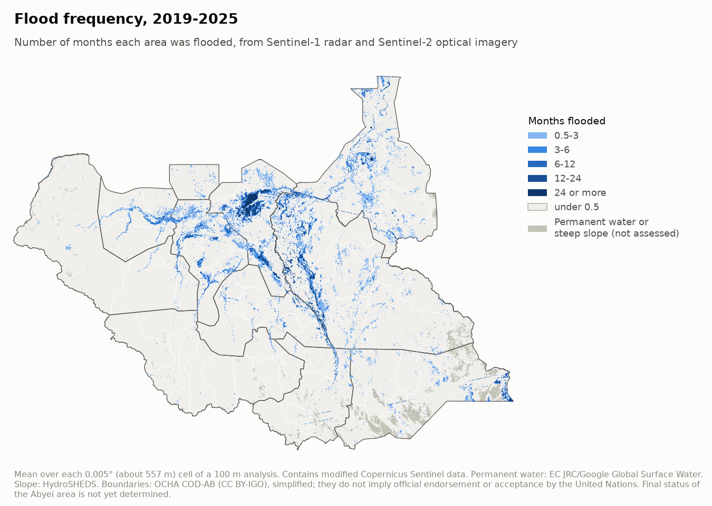
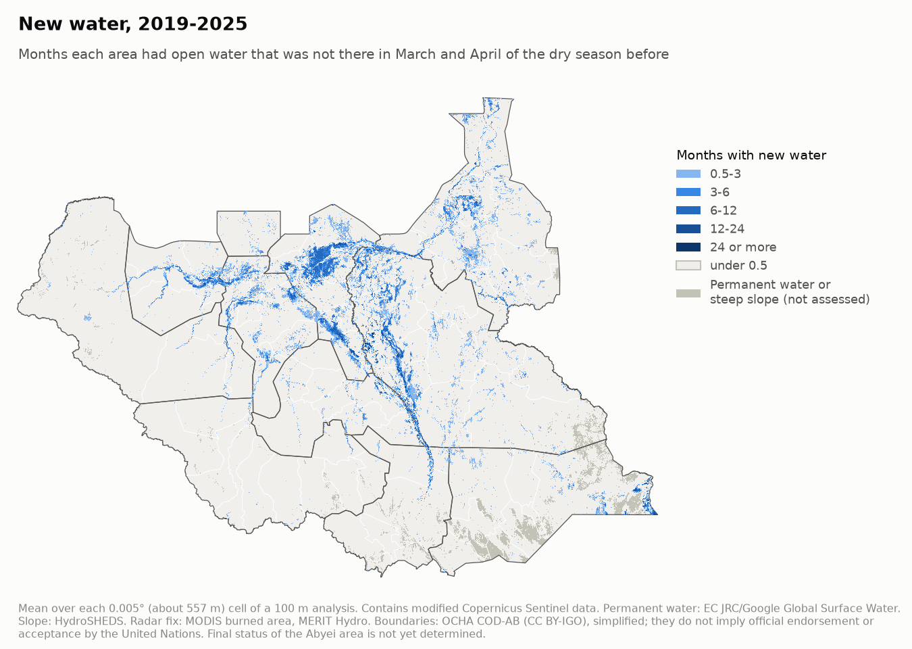
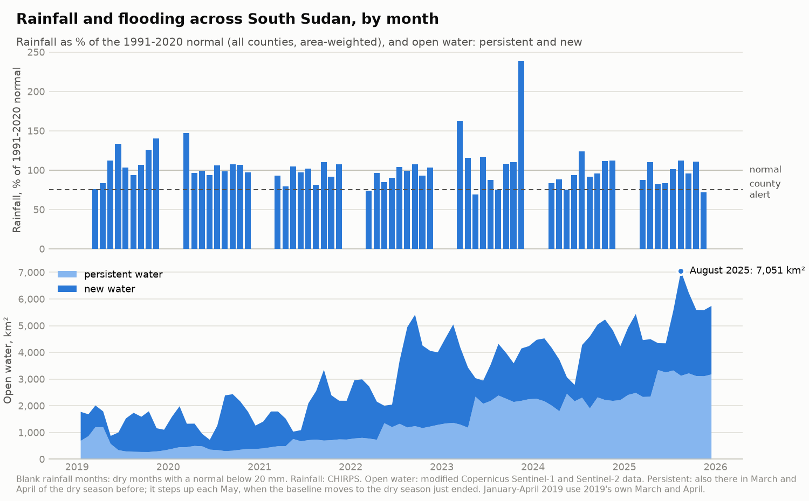
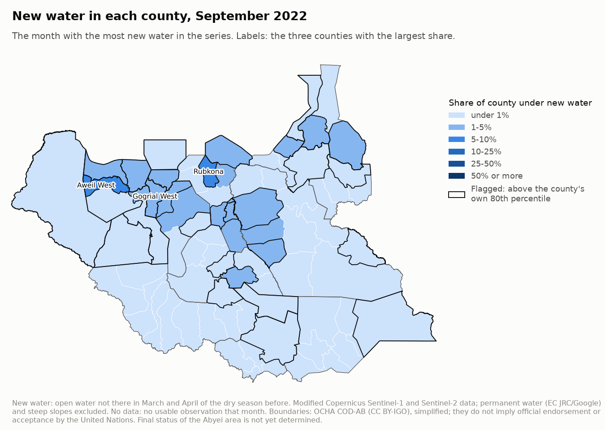
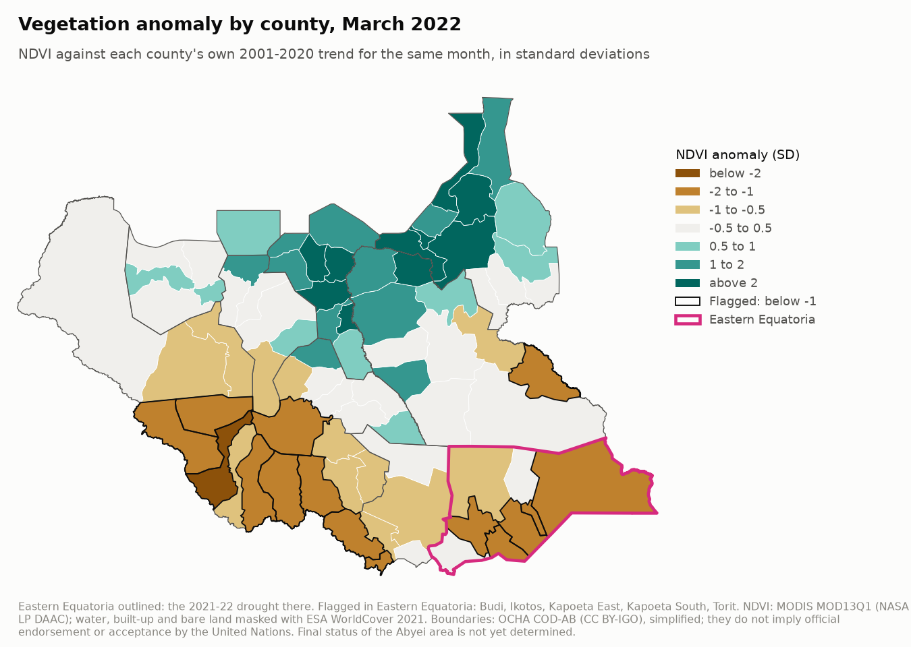

# south-sudan-flood-drought-monitor

[](https://github.com/JackPhilpott/south-sudan-flood-drought-monitor/actions/workflows/ci.yml)

Monthly flood, rainfall and vegetation indicators for each of South Sudan's 79 counties, 2019-2025,
from open satellite data, using the Google Earth Engine Python API and numpy.

From late 2019 to 2022 I designed and ran a flood and drought monitoring system for IMPACT
Initiatives (REACH) in South Sudan. It ran every month for over two years in Google Earth Engine
(Python): flood extent from a supervised classification of Sentinel-1 radar and Sentinel-2 and
Landsat optical imagery, CHIRPS rainfall and NDVI, reported by county. It produced monthly data,
quarterly factsheets and a dashboard used by OCHA, the clusters and partners, and we checked it on
the ground in three post-flood field assessments. Its outputs also fed two separate REACH
workflows, the Shocks Monitoring Index (SMI) and Integrated Needs Tracking (INT). A published map
from that work shows the kind of output it produced:
[drought in Eastern Equatoria, January 2022](https://repository.impact-initiatives.org/document/reach/7deca445/REACH_SSD_Map_SMI_Eastern_Equatoria_Drought_JAN2022_A4.pdf).
A related published REACH map, [flood frequency 2019-2021](https://repository.impact-initiatives.org/document/reach/c24a7620/REACH_SSD_Map_SMI_FloodFrequency2019_20_21_31JAN2022_A4-2.pdf),
used VIIRS flood data analysed by UNOSAT rather than this system's output.

This repo is an open-data rebuild of the monitoring part, written from scratch from my own
knowledge of the method. **It contains no REACH data or code:** every input is open data that the
scripts download (see [Data and licences](#data-and-licences)). The only REACH material is this
description, the links to the two published maps, and a link to a related repo. The original
classifier was trained on REACH's own training data, which are not open, so this rebuild maps open
water with documented threshold rules instead (a radar darkness threshold and an optical water
index, see [Open water, step by step](#open-water-step-by-step)). **All the results here, including
the agreement with JRC water and the flood flag's check against OCHA, describe this rebuild, not the
original system.** It reports each indicator on its own, with one documented alert flag each. It
does not combine them into an index like the SMI.

**Flood extent here means open water only.** Flooded grassland and swamp, which make up much of
the flooding in Jonglei, Unity and the Sudd, turn brighter on radar rather than darker and are not
detected. Flooded areas in this repo therefore sit well below the figures in humanitarian reports
on the 2019-2022 floods. See [Limitations](#limitations).

> **At a glance**
>
> - **What it is:** monthly rainfall, vegetation and open-water indicators for South Sudan's 79
>   counties, 2019-2025, from open satellite data with Earth Engine and Python; an open-data rebuild
>   of a system I ran at REACH.
> - **Validation (of this rebuild):** agreement with JRC's Landsat water maps in every county and
>   month of 2019-2021 is recall 0.565, precision 0.363. The flood flag caught 93 of 168
>   OCHA-listed flood-affected county-years, against 70.4 expected by chance: better than chance,
>   but modest.
> - **Key results:** open water peaked at 7,051 km² in August 2025. Water that stays after floods
>   has grown since 2019, from 296 km² a month in July-December 2019 to 3,185 km² in 2025, much of
>   it in Unity. Rainfall flagged the 2021 drought in Eastern Equatoria (33 county-months below 75%
>   of normal).
> - **The main limit:** open water only. Flooding under vegetation isn't detected, so areas sit far
>   below humanitarian estimates of flooded land, and the rain-fed 2019 floods hardly register.

## Figures and results



*Months each area had open water outside permanent water, 2019-2025. The water that has stayed
around Rubkona and Guit in Unity since the 2019-2022 floods stands out, along with the Nile corridor
through Jonglei, the Bahr el Ghazal and Bahr el Arab rivers and the Upper Nile floodplains.*



*The same, counting only new water: open water that was not there at the end of the dry season
before (in both March and April). The lakes that stayed in Unity drop out.*



*Top: national rainfall as % of the 1991-2020 normal. Bottom: open water outside permanent water,
split into persistent water (also there in March and April before) and new water. Persistent water
steps up each May, when the baseline moves to the dry season just ended; January-April 2019 use
2019's own March and April, so they show more persistent water than the months after.*

| | |
| :- | :- |
|  |  |
| *Share of each county under new water in September 2022, the month with the most new water. Outlined: counties flagged against their own record.* | *NDVI anomaly against each county's trend in March 2022, with Eastern Equatoria outlined: the drought there that the original system mapped in January 2022 ([published map](https://repository.impact-initiatives.org/document/reach/7deca445/REACH_SSD_Map_SMI_Eastern_Equatoria_Drought_JAN2022_A4.pdf)). Five of its eight counties are flagged; Western and Central Equatoria are below trend too.* |

What the run (January 2019 to December 2025, 79 counties) shows:

- **Coverage.** At least one sensor saw 91.8-97.5% of the country every month, so very few
  county-months lack a flood value.
- **Rainfall.** The July-October rains were above normal in 2019 in Jonglei (116%), Eastern
  Equatoria (117%) and Upper Nile (111%), and close to or below normal across the country in 2021
  (87-99% by state). 622 of the 4,340 county-months with a rainfall normal of at least 20 mm were
  flagged below 75% of normal, including 33 in Eastern Equatoria in 2021.
- **Open water.** The largest monthly total was 7,051 km² in August 2025, and the most new water
  4,176 km² in September 2022. Water that stays has grown since 2019: persistent water averaged
  296 km² a month in July-December 2019 and 3,185 km² in July-December 2025 (2024 was slightly
  below 2023). In Unity the
  July-November average rose from 171-369 km² in 2019-2021 to 1,292-2,432 km² in 2022-2025, as
  floodwater around Rubkona, Guit and Mayendit stayed; of that, 442-1,578 km² a month was
  persistent and 584-854 km² new.
- **The flood flag against OCHA.** The flag compares each county's new water with its own record
  for the same month (see [Alert flags](#alert-flags)). It fired for 971 of 6,636 county-months
  (14.6%). Against OCHA's lists of flood-affected counties its skill is better than chance but
  modest: it caught 93 of the 168 listed county-years, against 70.4 expected from a random flag
  firing as often (details below).
- **Vegetation.** 798 county-months (12.0%) were flagged for low NDVI, most in January 2019 (48
  counties), May 2024 (45) and May 2019 (43). These are dry-season months. January is the dormant
  season and burnt land lowers NDVI then, so January 2019's 48 are not a drought signal on their
  own. The 2021-22 drought in Eastern Equatoria shows best in March 2022 (5 of its 8 counties; see
  [Vegetation](#vegetation)).

**Why 2019 has the least new water of the seven years.** July-December 2019 averaged 1,197 km² of
new water a month, against 1,533-3,156 km² in the other years, although 2019 brought major floods.
The cause is the kind of flooding, not the data or the method. 2019's floods were mostly rain-fed,
shallow and spread through grassland, crops and settlements, which open-water mapping misses. The
river floods of 2020-2022 left large, lasting sheets of open water. The checks:

- *Not the data.* July-December 2019 had 734 Sentinel-1 scenes, as many as 2020 (737) and twice
  2022-2024 (338-350), and as many Sentinel-2 scenes as other years.
- *Not the persistent-water baseline.* 2019 uses its own March and April, but it has the least
  persistent water of all seven years (296 km²). Total open water is lowest in 2019 too (1,493 km²
  a month against 1,888 km² in 2020 and 2,470 km² in 2021), so 2019 would still rank last without
  the split.
- *Landsat sees the same.* JRC's independent Landsat water maps show 133 km² of open water per
  100,000 km² observed in July-December 2019, against 180 in 2020 and 242 in 2021.
- *The timing fits rain-fed floods.* The 2019 rains peaked late, at 126% of normal in October and
  140% in November, yet new water fell in November and December (868 and 777 km²).
- *The floods are visible where they were.* Jonglei had more new water in 2019 (490 km² a month)
  than in 2020 or 2021 (449 and 321 km²), and the flood flag fired for 12 of the 17 counties where
  IOM recorded flood displacement in September-October 2019 (4.7 expected by chance). The national
  total rose from 2020 with the Unity, Upper Nile and Bahr el Ghazal river floods.

## How it works

For every county and every month from January 2019 to December 2025:

| Indicator | Source | Reported | Alert flag |
| :- | :- | :- | :- |
| Rainfall | CHIRPS pentads, 0.05° | monthly total (mm), 1991-2020 normal, % of normal | below 75% of normal |
| Vegetation | MODIS MOD13Q1 NDVI, 250 m | monthly mean NDVI, the county's trend value for that month, anomaly from the trend | anomaly below -1 |
| Open water | Sentinel-1 radar and Sentinel-2 optical, analysed at 100 m | open water km² and % of county, km² flagged by each sensor, persistent and new water, % of county observed | new water above the county's own 80th percentile for that month, and at least 10 km² |

It also maps how many months each 100 m pixel had open water, and new water, over 2019-2025,
comparable in form to the published 2019-2021 flood frequency map (which used VIIRS flood data
analysed by UNOSAT).

### Pipeline

The work runs in two stages. Earth Engine computes the monthly flood flags from Sentinel-1 and
Sentinel-2 once and stores them as yearly assets, along with the rainfall and NDVI tables. Everything
after that runs locally on downloaded layers. Reading stored pixels from Earth Engine is cheap, but
computing on them there is not: a cost test of the second stage in Earth Engine projected 26-49
EECU-hours, against about 3.5 for downloading the layers and processing them with numpy.

[`scripts/monitor.py`](scripts/monitor.py) runs each step:

| Step | Command | Earth Engine? |
| :- | :- | :- |
| County boundaries (OCHA COD-AB) from HDX, simplified copy in [`data/`](data/README.md) | `boundaries` | no |
| Rainfall and NDVI tables, and the monthly flood flags as yearly assets (batch exports, rerun until done) | `submit`, `status`, `download` | yes |
| Copy the stored flood layers and the extra layers onto one local 100 m grid in `cache/` | `download-layers --years 2019-2025` | yes (reads) |
| Apply the radar fix, split persistent and new water, county tables, JRC agreement, frequency maps | `rebuild` | no |
| OCHA's flood-affected counties from HDX into `data/ocha_flood_counties.csv` | `ocha` | no |
| Normals, anomalies, shares and flags: `county_monthly.csv`, `national_monthly.csv` | `build` | no |
| The flood flag rules against OCHA: `flood_flag_check.csv` | `flag-check` | no |
| The five figures | `plots` | no |

The tests that chose the method can be rerun too: `cost-test`, `benchmark` (the six-county design
test), `radar-fix-test` (every candidate radar fix), `reproduce-check` (local route against Earth
Engine), `optical-test` (Sentinel-2 cloud and water thresholds), and `optical-clear` with `veto-test`
(the optical veto).

The Earth Engine code is in [`earthengine`](src/ssd_monitor/earthengine.py),
[`rainfall`](src/ssd_monitor/rainfall.py), [`vegetation`](src/ssd_monitor/vegetation.py),
[`flood`](src/ssd_monitor/flood.py), [`radar_fixes`](src/ssd_monitor/radar_fixes.py),
[`validation`](src/ssd_monitor/validation.py) and [`exports`](src/ssd_monitor/exports.py).
Everything else is plain Python and is tested without an Earth Engine account. Settings are in
[`config.yml`](config.yml); the Earth Engine project ID comes from the `EE_PROJECT` environment
variable.

### Rainfall

CHIRPS pentads split each month into six periods, so their sum is the month's total. The script
takes the county mean of that total for every month from 1991 to 2025. The **normal** is the mean
of the county's totals for the same calendar month over 1991-2020, and **% of normal** is the
month's total divided by the normal. In dry months the normal is close to zero, and a few mm of
rain would show as several hundred per cent, so % of normal is left blank when the normal is
below 20 mm.

### Vegetation

MOD13Q1 is a 16-day NDVI composite at 250 m. A month's NDVI is the mean of the composites whose
16-day period starts in that month, using only pixels rated good or marginal. Water, built-up and
bare land are masked with ESA WorldCover.

Vegetation in 78 of the 79 counties has grown greener since 2001, so a fixed 2001-2020 mean flagged
fewer and fewer months: 22.9% of county-months in 2001-2010, 3.3% in 2019-2025. Each county's NDVI
is therefore compared with its own trend. For every county and calendar month, a straight line is
fitted to NDVI against year over 2001-2020 and extended to later years; the **anomaly** is (NDVI −
trend value) / the standard deviation of the 2001-2020 values around the line. Only the baseline
years shape the line, so a new month doesn't change it. Flag rates are now steady: 14.9% of
county-months in 2001-2010, 15.4% in 2011-2020 and 12.0% in 2019-2025, close to the 16% a −1
standard deviation threshold gives by design.

**January is the dormant season**, when vegetation is dry in every year, so NDVI says little about
drought then. The January 2022 drought in Eastern Equatoria that the original system mapped shows
only weakly in January itself (1 of 8 counties flagged, mean anomaly −0.55) and more in the months
around it: June 2021 (4 of 8, after the June rains failed at 56% of normal), December 2021 (3 of 8)
and March 2022 (5 of 8). Rainfall picks it up more clearly: 33 county-months in Eastern Equatoria
were flagged below 75% of normal in 2021. Dry-season NDVI also drops where land has burnt, which is
likely part of the January 2019 signal.

Normals, trends and anomalies are computed from the county values in `outputs/raw/`, so anyone can
recompute them from the CSVs. They are left blank where fewer than 75% of the baseline years have a
value.

### Open water, step by step

The structure follows the
[UN-SPIDER recommended practice for flood mapping with Sentinel-1 in Earth Engine](https://www.un-spider.org/advisory-support/recommended-practices/recommended-practice-google-earth-engine-flood-mapping):
find water on radar, then remove permanent water, steep slopes and isolated pixels. UN-SPIDER maps
a single event; this repo runs every month and adds Sentinel-2 optical data, as the original system
did. Every threshold is in `config.yml`.

1. **Radar flag** ([`flood.py`](src/ssd_monitor/flood.py)). Calm open water reflects the radar
   signal away from the satellite, so it looks dark. For each orbit direction, the month's median VV
   backscatter is taken, and a pixel is flagged when it is at or below −18 dB in either direction.
2. **Optical flag.** Sentinel-2 surface reflectance scenes from the month, skipping scenes that are
   more than 80% cloud, with cloudy pixels masked by Cloud Score+ (clear score below 0.6). A pixel is
   flagged when the month's median MNDWI = (green − SWIR1) / (green + SWIR1) of its clear views is
   above 0.
3. **Combine and store.** A pixel is water where either sensor flags it, except permanent water
   (water in at least 80% of observations in JRC Global Surface Water, 1984-2021), steep slopes
   above 5° (HydroSHEDS) and patches of fewer than 8 connected pixels (8 ha). Each month's flags are
   packed into one byte per pixel and stored as a yearly Earth Engine asset, so this expensive part
   runs once.
4. **Radar fix** ([`rebuild.py`](src/ssd_monitor/rebuild.py)). Burnt grassland and some dry soils
   are as dark on radar as water. So radar-only water (flagged by radar, not by optical imagery) is
   removed where any of these holds:
   - the land burnt since 1 November (MODIS burned area), applied November to May only, so a burn
     can never remove water in a wet-season flood;
   - it lies more than 5 m above the nearest drainage (MERIT Hydro HAND), where water can't pond;
   - it lies within 300 m of a Sentinel-1 scene outline, where scene edges left dark straight lines.

   The patch filter is then applied again.
5. **Persistent and new water.** Water that was there in both March and April of the preceding dry
   season (the driest point of the year) is **persistent**; the rest is **new**. May to December
   use that year's March and April, January to April the year before's (2019, the first year, uses
   its own).
6. **County areas.** The area of every flagged 100 m pixel is added up per county: open water, the
   km² each sensor flagged, persistent and new water, and the km² observed by either sensor. If no
   sensor saw any of a county that month, its values are left blank rather than 0.
7. **Frequency maps.** The months of open water, and of new water, per 100 m pixel over 2019-2025,
   averaged into 0.005° cells (about 550 m).

**The first run under-counted flooded areas.** The stored flags have partial pixel masks, because
Earth Engine averages the masks of cloudy or edge sub-pixels when it reads 10 m imagery at 100 m.
Earth Engine's default weighted sum then counted each flagged pixel at only part of its area, so the
first run's county tables were 11-56% too low in the 36 months checked (2019-2021), depending on
the month (in March 2020, 1,429 km² instead of 1,854 km²). The pixel values were right. The local route counts whole pixels, and checks
against Earth Engine itself: for March 2020 it reproduces Earth Engine's own per-pixel class counts
to within 0.03% for every class (0.6% for JRC water, from resampling), and the radar-only area under
each candidate fix to within 0.1 km² in the four test counties
(`outputs/radar_fix_test/reproduction_2020-03_*.csv`).

**Why a darkness rule and not change detection.** The first design followed UN-SPIDER more closely:
a pixel was water when it had become at least 3 dB darker than a dry-season reference and VV was
below −15 dB. In a test in six flood-prone counties, it found less than half of the water that
JRC's Landsat maps saw, because the clay plains of Jonglei and Unity are already dark on radar in
the dry season. A plain darkness threshold agreed better and replaced it.

### Choosing the radar fix

Every combination of four candidate fixes (burn masks, HAND above 5, 10 or 15 m, "dark in the
dry-season reference needs optical agreement", and the scene-edge mask) was scored against JRC
monthly water on the set below, with the patch filter re-applied for each. The full table of 48 rules
is in `outputs/radar_fix_test/rule_scores.csv`; the main ones (from that test, whose burn mask also
reached back two months from June to October; the final layer's scores are in the next section):

| Rule | Recall all / dry / wet | Precision all / dry / wet | JRC water removed |
| :- | :- | :- | -: |
| No fix | 0.569 / 0.558 / 0.582 | 0.294 / 0.257 / 0.350 | 0 km² |
| Burn mask (season) | 0.567 / 0.554 / 0.582 | 0.351 / 0.351 / 0.351 | 78 km² |
| HAND above 5 m | 0.569 / 0.557 / 0.581 | 0.301 / 0.264 / 0.356 | 23 km² |
| Scene edges | 0.568 / 0.557 / 0.580 | 0.300 / 0.263 / 0.356 | 59 km² |
| Dark in the dry-season reference | 0.447 / 0.428 / 0.469 | 0.317 / 0.301 / 0.334 | 3,979 km² |
| **Burn + HAND 5 m + edges (used)** | 0.565 / 0.552 / 0.579 | 0.363 / 0.366 / 0.360 | 158 km² |

The dry-season-reference rule removed the most false water but also 3,979 km² of water JRC confirmed,
12% of all JRC water, so it was dropped. In the counties where false water was worst, the fix used
cuts it by a quarter to two thirds (flagged km² that JRC saw as dry ground):

| County | March 2019 | March 2020 | March 2021 |
| :- | :- | :- | :- |
| Gogrial East (Warrap) | 455 → 204 | 60 → 40 | 33 → 21 |
| Tonj North (Warrap) | 359 → 118 | 106 → 53 | 92 → 64 |
| Tonj South (Warrap) | 331 → 177 | 170 → 121 | 67 → 51 |
| Kapoeta East (Eastern Equatoria) | 383 → 269 | 18 → 9 | 174 → 117 |

Two further tests were not adopted:

- **An optical veto**: drop radar-only water where Sentinel-2 had a clear view that month and saw no
  water. Sentinel-2 clear views, judged on 200 m cells from Cloud Score+ (the same answer as 100 m
  for 99.99% of radar-only pixels in March 2020), were added for 2019-2021. In December-May it lifted
  dry-season precision from 0.366 to 0.563 but cut overall recall from 0.565 to 0.466, removing
  3,217 km² of JRC water, far beyond the agreed limit (a precision gain of at least 0.05 for at most
  0.01 of recall). All year, recall fell to 0.389.
- **Stricter optical masking**: re-running the optical rule in ten counties and six months with
  stricter Cloud Score+ thresholds (cs_cdf 0.7 or 0.8, or the `cs` band at 0.6) did not raise its
  precision against JRC (wet season 0.370 now, 0.339-0.376 stricter) and cost recall. So clouds and
  shadows slipping through are not the cause of the optical layer's misses. Only a stricter water
  threshold (MNDWI above 0.1) raised precision (0.493 to 0.584), at too high a cost in recall (0.427
  to 0.262): the misses are borderline pixels such as wet soil and mixed or vegetated water
  (`outputs/radar_fix_test/optical_variants.csv`).

### Agreement with JRC monthly water

[JRC's Global Surface Water monthly history](https://developers.google.com/earth-engine/datasets/catalog/JRC_GSW1_4_MonthlyHistory)
maps open water month by month from Landsat, independently of this project, up to December 2021.
The flood layer is compared with it pixel by pixel at 100 m in **all 79 counties and every month of
2019-2021**, wherever Landsat had a view, leaving out permanent water and steep slopes (32,564 km²
of JRC water over the 36 months). Recall is the share of JRC's water that the layer also flags;
precision is the share of the layer's flagged area that JRC also calls water.

| Season | Recall | Precision |
| :- | -: | -: |
| All months | 0.565 | 0.363 |
| Dry season (December-May) | 0.552 | 0.366 |
| Wet season (June-November) | 0.579 | 0.359 |

These figures describe this rebuild, not the original system, and they measure **agreement with
JRC monthly water, not accuracy**. JRC has its own errors,
it only covers open water that Landsat saw (so flooding under vegetation is missing from both), and
where Landsat saw no water, Sentinel-2's MNDWI often finds wet soil or mixed water at the edges. The
per county-month areas are in `outputs/raw/jrc_agreement.csv`.

This set replaces an earlier design test in six flood-prone counties and three months, which chose
the darkness rule (recall 0.65, precision 0.62 for the flood layer there). That test covered mostly
flood-season water in flood counties, where agreement is highest, and used Earth Engine's
mask-weighted sums, so its figures aren't comparable with the table above. It is kept in
`outputs/benchmark_jrc.csv` as the record of that choice.

### Alert flags

| Column | Flag raised when | Setting in `config.yml` |
| :- | :- | :- |
| `flag_rain_low` | rainfall below 75% of the 1991-2020 normal | `alerts.rain_pct_normal_below` |
| `flag_ndvi_low` | NDVI anomaly below −1 standard deviation from the county's trend | `alerts.ndvi_anomaly_below` |
| `flag_flood` | new water above the county's own 80th percentile for that calendar month (over 2019-2025), and at least 10 km² | `alerts.flood_new_percentile`, `alerts.flood_new_min_km2` |

Each flag is true, false, or blank when its indicator is missing, so "no data" is never read as
"no problem". There is no combined score.

**Choosing the flood flag.** The first run's flag (more than 10% of a county under open water)
fired almost only in Unity, where water that never drained counted as flooded every month. Two
county-relative rules on new water were set before any comparison: R1 above (own record) and R2,
new water above 5% of the county's land within 5 m of the nearest drainage (MERIT Hydro HAND). Each
was checked against OCHA's lists of counties with people affected by floods, as county-years
flagged in any July-December month. The chance baseline is the number of hits a random flag would
get if it fired for the same number of counties: flagged × listed / 79. 2019's list is partial (IOM
displacement sites only), so 2019 counts hits but not false alarms.

| Year | Counties listed | R1: flagged / hits / chance | R2: flagged / hits / chance | Old 10% rule: flagged / hits / chance |
| :- | -: | :- | :- | :- |
| 2019 (partial) | 17 | 22 / 12 / 4.7 | 1 / 1 / 0.2 | 0 / 0 / 0.0 |
| 2021 | 33 | 27 / 15 / 11.3 | 3 / 2 / 1.3 | 0 / 0 / 0.0 |
| 2022 | 39 | 44 / 24 / 21.7 | 9 / 9 / 4.4 | 2 / 2 / 1.0 |
| 2024 | 41 | 36 / 24 / 18.7 | 3 / 3 / 1.6 | 2 / 2 / 1.0 |
| 2025 | 38 | 29 / 18 / 13.9 | 3 / 2 / 1.4 | 3 / 3 / 1.4 |
| **Total** | **168** | **158 / 93 / 70.4** | **19 / 17 / 8.9** | **7 / 7 / 3.5** |

Over all five years, each rule against a random flag that fires for the same number of counties
each year (false alarms count 2021-2025 only, as the 2019 list is partial):

| Rule | Flagged | Hits (chance) | Misses (chance) | False alarms (chance) |
| :- | -: | :- | :- | :- |
| R1, own record (adopted) | 158 | 93 (70.4) | 75 (97.6) | 55 (70.4) |
| R2, low-lying land | 19 | 17 (8.9) | 151 (159.1) | 2 (9.3) |
| Old rule, open water above 10% | 7 | 7 (3.5) | 161 (164.5) | 0 (3.5) |

R1 was adopted by the rule fixed beforehand: the most hits above chance (22.6, against 8.1 for R2
and 3.5 for the old rule). **Its skill is better than chance but modest**: 93 of 168 listed
county-years against 70.4 expected, with 75 misses and 55 false alarms; it does best in 2019. R2
is rarely wrong but rarely fires, and the old rule hardly fires at all. OCHA lists people affected
by any flooding, including rain and flash floods and flooding under vegetation, so an open-water
flag can't match it closely. Like the JRC figures, this describes this rebuild's flag, not the
original system. The table is `outputs/flood_flag_check.csv`.

### Scales and cost

| Indicator | Native resolution | Processing scale |
| :- | :- | :- |
| Rainfall | 0.05° (~5.5 km) | 5,566 m |
| Vegetation | 250 m | 250 m |
| Open water | 10 m (radar), 10-20 m (optical) | 100 m |

A national monthly analysis at 10 m would read 100 times as many pixels as at 100 m. At 100 m each
pixel is one hectare, still fine enough for floodplains and county totals, and reading the imagery
from Earth Engine's averaged pyramid also smooths radar speckle. Floods narrower than about 100 m,
along small channels for example, are missed or diluted.

**Measured cost.** The yearly flood layers for all 84 months used 61.3 EECU-hours by Earth Engine's
task records (7.0-10.7 a year, following the number of Sentinel-1 scenes), and the whole first run
about 81. The method update that followed used about 9.3 EECU-hours: 3.6 to download the stored
layers and extra layers, 2.9 for the optical clear-view layer and its cost tests, 2.0 for the
optical sample, and 0.9 for cost tests and aborted downloads. Earth Engine's task records
under-report table exports, so those were measured with its profiler.

### Outputs

All files are in [`outputs/`](outputs/) except the local cache.

| File | Contents |
| :- | :- |
| `county_monthly.csv` | one row per county and month, with every indicator and flag |
| `national_monthly.csv` | national monthly totals and means, and the number of counties flagged |
| `raw/rainfall.csv`, `raw/ndvi.csv` | the Earth Engine county tables |
| `raw/flood.csv` | open water, by sensor, persistent and new, and observed area per county-month (from `rebuild`) |
| `raw/jrc_agreement.csv` | the JRC comparison per county-month, 2019-2021 |
| `raw/low_lying_land.csv` | each county's land within 5 m of the nearest drainage (for R2) |
| `flood_frequency_2019_2025.tif`, `new_water_frequency_2019_2025.tif` | GeoTIFFs: band 1 months × 10, band 2 % of the cell excluded (permanent water or steep slope) |
| `flood_flag_check.csv` | the flood flag rules against OCHA, per year |
| `radar_fix_test/` | the radar-fix, veto, optical and reproduction tests |
| `benchmark_jrc.csv`, `benchmark_jrc_summary.csv` | the six-county design test |
| `figures/*.png` | the five figures |

Columns of `county_monthly.csv`: `county_code`, `county_name`, `state_code`, `state_name`,
`month`, `area_km2`; `rain_mm`, `rain_normal_mm`, `rain_pct_normal`; `ndvi`, `ndvi_expected`,
`ndvi_residual_sd`, `ndvi_anomaly`; `flooded_km2` (all open water), `flooded_pct`,
`flooded_sar_km2`, `flooded_optical_km2`, `persistent_km2`, `new_km2`, `new_pct`,
`flood_observed_pct`; `flag_rain_low`, `flag_ndvi_low`, `flag_flood`.

## Quick start

### With pip

Python 3.12 (as in CI and Docker); the tests also pass on 3.13.

```bash
python -m venv .venv
source .venv/bin/activate          # Windows: .venv\Scripts\activate
pip install -r requirements.txt

pytest                             # unit tests, no Earth Engine needed
ruff check . && ruff format --check .
```

The tables and figures rebuild from the committed outputs without Earth Engine:

```bash
python scripts/monitor.py build      # county_monthly.csv and national_monthly.csv
python scripts/monitor.py flag-check # flood flag rules against OCHA
python scripts/monitor.py plots      # the five figures
```

To run the whole monitor you need a Google Cloud project registered for Earth Engine (free for
non-commercial use, see [Earth Engine access](https://developers.google.com/earth-engine/guides/access)):

```bash
earthengine authenticate            # once per machine
export EE_PROJECT=your-project-id   # PowerShell: $env:EE_PROJECT = "your-project-id"

python scripts/monitor.py cost-test                       # one month of each export; run again for the estimate
python scripts/monitor.py submit                          # run again until every export is done
python scripts/monitor.py status                          # progress and EECU used
python scripts/monitor.py download                        # rainfall and NDVI tables
python scripts/monitor.py download-layers --years 2019-2025  # the local cache, about 0.35 GB
python scripts/monitor.py rebuild                         # radar fix, persistent and new water, county tables
python scripts/monitor.py ocha
python scripts/monitor.py build
python scripts/monitor.py flag-check
python scripts/monitor.py plots
```

The cache (`cache/`, git-ignored) holds every layer on the stored layers' 100 m grid, as compressed
GeoTIFF tiles; downloads resume where they stopped.

### With Docker

The image installs `requirements.txt` on `python:3.12-slim` and runs the tests by default:

```bash
docker build -t south-sudan-flood-drought-monitor .
docker run --rm south-sudan-flood-drought-monitor
```

To run the monitor in the container, pass in your project ID and your existing Earth Engine
credentials (mounted read-only), and mount `outputs/` and `cache/`:

```bash
docker run --rm \
  -e EE_PROJECT=your-project-id \
  -v ~/.config/earthengine:/root/.config/earthengine:ro \
  -v "$(pwd)/outputs:/app/outputs" -v "$(pwd)/cache:/app/cache" \
  south-sudan-flood-drought-monitor python scripts/monitor.py submit
```

## Tests and CI

The [tests](tests/) cover everything that doesn't need Earth Engine, using four invented counties
and invented values:
- **Inputs:** the settings, month windows and burn windows, and planning the exports and cost test.
- **Processing:** packing the flood flags into one byte, the local cache and its tiles, the patch
  filter (checked in strips and on the flagged-pixel graph against full-array labelling), and the
  radar fixes and the rebuild with persistent and new water on a synthetic cache.
- **Statistics:** the JRC scores, the normals and the detrended NDVI anomaly, the flood flag rules
  and their check against OCHA, and reading the OCHA files.
- **Outputs:** the national summary, the GeoTIFFs, the five figures, and the `build` and `plots`
  commands end to end.

One test checks that the offline modules never import Earth Engine.

[GitHub Actions](.github/workflows/ci.yml) runs on every push and pull request: `ruff check`,
`ruff format --check` and `pytest` on Python 3.12, then it builds the Docker image and runs the
tests inside it. CI makes no Earth Engine calls and holds no credentials.

## Data and licences

| Data | Used for | Licence and attribution |
| :- | :- | :- |
| [CHIRPS](https://developers.google.com/earth-engine/datasets/catalog/UCSB-CHG_CHIRPS_PENTAD) pentads (UCSB Climate Hazards Center) | rainfall | public domain: the authors have waived all copyright. Funk et al. (2015) |
| [MODIS MOD13Q1 v6.1](https://developers.google.com/earth-engine/datasets/catalog/MODIS_061_MOD13Q1) (NASA LP DAAC) | NDVI | no restrictions on use or redistribution. Didan (2021) |
| [MODIS MCD64A1 v6.1](https://developers.google.com/earth-engine/datasets/catalog/MODIS_061_MCD64A1) burned area (NASA LP DAAC) | radar fix (burn mask) | no restrictions on use or redistribution. Giglio et al. (2021) |
| [Sentinel-1 GRD](https://developers.google.com/earth-engine/datasets/catalog/COPERNICUS_S1_GRD) and [Sentinel-2 surface reflectance](https://developers.google.com/earth-engine/datasets/catalog/COPERNICUS_S2_SR_HARMONIZED) (Copernicus, ESA) | open water | [Copernicus Sentinel data terms](https://sentinels.copernicus.eu/documents/247904/690755/Sentinel_Data_Legal_Notice): free and open, with attribution. The outputs contain modified Copernicus Sentinel data 2019-2025 |
| [Cloud Score+](https://developers.google.com/earth-engine/datasets/catalog/GOOGLE_CLOUD_SCORE_PLUS_V1_S2_HARMONIZED) (Google) | Sentinel-2 cloud mask, optical clear views | CC BY 4.0. Pasquarella et al. (2023) |
| [JRC Global Surface Water v1.4](https://developers.google.com/earth-engine/datasets/catalog/JRC_GSW1_4_GlobalSurfaceWater), [monthly](https://developers.google.com/earth-engine/datasets/catalog/JRC_GSW1_4_MonthlyHistory) and [yearly](https://developers.google.com/earth-engine/datasets/catalog/JRC_GSW1_4_YearlyHistory) history | permanent water mask; agreement check | free, without restriction of use, under the Copernicus programme. Source: EC JRC/Google. Pekel et al. (2016) |
| [MERIT Hydro v1.0.1](https://developers.google.com/earth-engine/datasets/catalog/MERIT_Hydro_v1_0_1) height above nearest drainage (Yamazaki et al.) | radar fix (HAND above 5 m); low-lying land for R2 | dual-licensed CC BY-NC 4.0 or ODbL 1.0; used here under **ODbL 1.0** (see below). Yamazaki et al. (2019) |
| [ESA WorldCover 2021 v200](https://developers.google.com/earth-engine/datasets/catalog/ESA_WorldCover_v200) | NDVI land mask | CC BY 4.0. Zanaga et al. (2022) |
| [HydroSHEDS void-filled DEM](https://developers.google.com/earth-engine/datasets/catalog/WWF_HydroSHEDS_03VFDEM) (WWF) | slope mask | free for non-commercial and commercial use under the [HydroSHEDS licence](https://www.hydrosheds.org/page/license). Lehner et al. (2008) |
| [OCHA COD-AB South Sudan](https://data.humdata.org/dataset/cod-ab-ssd) (South Sudan IMWG, NBS, IOM and OCHA, via HDX) | county boundaries | [CC BY-IGO](https://creativecommons.org/licenses/by/3.0/igo/legalcode). A simplified copy is committed in [`data/`](data/README.md) |
| [South Sudan: Flood Data](https://data.humdata.org/dataset/south-sudan-flood-data) (OCHA South Sudan, via HDX): reported flood-affected people by county, 2021, 2022, 2024, 2025 | checking the flood flag | CC0 (public domain) |
| [South Sudan: Flood Locations](https://data.humdata.org/dataset/south-sudan-flood-locations) (IOM DTM flood displacement locations, end of October 2019, posted by OCHA South Sudan on HDX) | checking the flood flag (2019) | CC BY 4.0. Source: IOM Displacement Tracking Matrix |

The satellite data are read through the Earth Engine API; `scripts/monitor.py boundaries` and
`ocha` download the boundaries and the OCHA and IOM files from HDX. `data/ocha_flood_counties.csv`
lists, per year, the counties those files report, with each file named as its source. In
`ocha.py`, a few 2021 county names are matched to COD-AB spellings, and a few 2019 locations whose
county code disagrees with their payam code are assigned by the payam code.

**Licences of this repo's outputs.** The code is MIT. The files in `outputs/` include data derived
from MERIT Hydro (the radar fix and the low-lying land), so they are released under the
[Open Database License (ODbL) 1.0](https://opendatacommons.org/licenses/odbl/1-0/), as MERIT Hydro's
ODbL option requires, with the attributions above. `data/ocha_flood_counties.csv` is released
under CC BY 4.0, attributing OCHA South Sudan and IOM DTM. The boundaries and names shown and the
designations used do not imply official endorsement or acceptance by the United Nations. Final
status of the Abyei area is not yet determined.

## Limitations

**Open water only.** The radar flag looks for dark surfaces. Where water stands under grass, papyrus
or trees, the radar signal bounces between the water and the stems and the pixel gets *brighter*;
normal wet-season vegetation and wet soil brighten too, so brightening can't be used on its own,
and optical imagery can't see through the canopy either. In Twic East (Jonglei) in September 2020, a
month of severe flooding, JRC's Landsat maps show 80 km² of open water outside permanent water, 1.3%
of the county, and this repo 104 km². Areas here therefore sit far below humanitarian estimates of
flooded land, crops and homes, and the 2019 floods hardly register nationally (see above).

**False radar water remains in the dry season.** The fix cuts it by a quarter to two thirds where
it was worst, but Warrap still shows 118-204 km² per county of radar water that JRC saw as dry ground in
March 2019, and nationally only 0.36 of the flagged area agrees with JRC water. MODIS maps burns at
500 m and misses small ones, and some dark dry soils aren't burnt or high above drainage.

**The flood flag is relative and retrospective.** R1 compares each month with the county's own
record over the whole period, so it fires in roughly the wettest one or two years per county by
design (14.6% of county-months), and adding years changes earlier flags. An operational version
would compare only with past years. Its agreement with OCHA is modest (above).

**Persistent water depends on two months.** Water seen in both March and April counts as
persistent for the following year. If either month is badly observed or holds false radar water,
the split shifts; 2019 uses its own dry season because the run starts then.

**Optical misses.** Where Landsat saw no water, Sentinel-2's MNDWI often flags wet soil or mixed
water at the edges of water bodies: optical precision against JRC is 0.32 in the wet season, and
stricter cloud masking doesn't change it (above).

**Sentinel-1 coverage is thinner in 2022-2024.** Sentinel-1B failed in December 2021, which left
Sentinel-1A alone until Sentinel-1C joined in 2025. Some months have no radar pass over part of the
country in one or both directions; those areas count as unobserved, not dry. More scenes in 2025
probably add detections, so years are not strictly comparable.

**Seasonal wetlands count as water.** Open water that isn't permanent (in at least 80% of Landsat
observations since 1984) counts whenever it appears, so floodplains that fill every rainy season
are new water every year.

**County averages hide local extremes.** A county can pass every threshold while one part of it is
badly flooded or very dry. The frequency maps show where within a county water appears.

**No field verification in this version.** The original system was checked on the ground in three
post-flood field assessments. This rebuild has not been validated in the field.

**Smaller points.** Floods narrower than about 100 m are missed. The simplified boundaries change
county areas by less than 0.03% compared with COD-AB. The optical clear views used in the veto test
were judged on 200 m cells, to keep the cost down.

## Future work

1. **Flooded vegetation.** Water under grass, papyrus or trees brightens the radar signal through
   double bounce, which the VH/VV ratio and changes in VV can pick up. Telling that apart from
   ordinary wet-season growth would need a reference dataset of mapped flooded vegetation to
   calibrate and test against.
2. **Hold-out validation of the flood flag.** R1's percentile and floor, and R2's share, were set
   before the OCHA comparison but checked on all the years at once. Fitting them on some years and
   testing on the others would show how well they hold up.
3. **A county list for 2020.** OCHA's final 2020 flooding report counts 49 flood-affected counties
   without naming them; a published county list would add the biggest flood year to the check.
4. **An operational monthly update.** Run each new month as it arrives: the Earth Engine export for
   that month, the cache download, the local rebuild and the tables, with the flood flag compared
   only with past years.

## References

- Didan, K. (2021). MODIS/Terra Vegetation Indices 16-Day L3 Global 250m SIN Grid V061. NASA EOSDIS
  Land Processes DAAC. [doi:10.5067/MODIS/MOD13Q1.061](https://doi.org/10.5067/MODIS/MOD13Q1.061)
- Funk, C., Peterson, P., Landsfeld, M., et al. (2015). The climate hazards infrared precipitation
  with stations: a new environmental record for monitoring extremes. *Scientific Data*, 2, 150066.
  [doi:10.1038/sdata.2015.66](https://doi.org/10.1038/sdata.2015.66)
- Giglio, L., Justice, C., Boschetti, L. and Roy, D. (2021). MODIS/Terra+Aqua Burned Area Monthly
  L3 Global 500m SIN Grid V061. NASA EOSDIS Land Processes DAAC.
  [doi:10.5067/MODIS/MCD64A1.061](https://doi.org/10.5067/MODIS/MCD64A1.061)
- Lehner, B., Verdin, K. and Jarvis, A. (2008). New global hydrography derived from spaceborne
  elevation data. *Eos, Transactions, AGU*, 89(10), 93-94.
- Pasquarella, V. J., Brown, C. F., Czerwinski, W. and Rucklidge, W. J. (2023). Comprehensive
  quality assessment of optical satellite imagery using weakly supervised video learning.
  *CVPR Workshops*, 2125-2135. [doi:10.1109/CVPRW59228.2023.00206](https://doi.org/10.1109/CVPRW59228.2023.00206)
- Pekel, J.-F., Cottam, A., Gorelick, N. and Belward, A. S. (2016). High-resolution mapping of
  global surface water and its long-term changes. *Nature*, 540, 418-422.
  [doi:10.1038/nature20584](https://doi.org/10.1038/nature20584)
- Yamazaki, D., Ikeshima, D., Sosa, J., Bates, P. D., Allen, G. H. and Pavelsky, T. M. (2019). MERIT
  Hydro: a high-resolution global hydrography map based on latest topography datasets. *Water
  Resources Research*, 55, 5053-5073. [doi:10.1029/2019WR024873](https://doi.org/10.1029/2019WR024873)
- Zanaga, D., Van De Kerchove, R., Daems, D., et al. (2022). ESA WorldCover 10 m 2021 v200.
  [doi:10.5281/zenodo.7254221](https://doi.org/10.5281/zenodo.7254221)

## Related repos

- [methane-s5p-explorer](https://github.com/JackPhilpott/methane-s5p-explorer): Sentinel-5P
  methane with the Earth Engine Python API.
- [south-sudan-aok-pipeline](https://github.com/JackPhilpott/south-sudan-aok-pipeline): REACH's
  Area of Knowledge pipeline for South Sudan (R), monthly key-informant data on hard-to-reach
  settlements.

## Licence

Code: [MIT](LICENSE). Outputs: ODbL 1.0, see [Data and licences](#data-and-licences).

Built with AI-assisted development, reviewed and tested by me.
